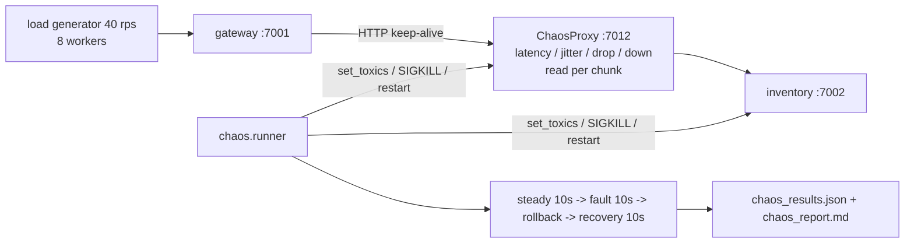

# chaos-kit: fault injection for a sample microservice, with measured results

> **Lab project.** It runs on one host. The "microservice" is two small FastAPI services (gateway → inventory). Faults are injected by my own toxiproxy-style TCP proxy (`chaos/proxy.py`) and by SIGKILL. It doesn't use tc/netem, which needs root.

## Problem
"We have retries and timeouts" isn't evidence. Chaos engineering states a **steady-state hypothesis** (here: error rate ≤ 1% and p95 ≤ 400 ms at the gateway), injects a real fault, measures, rolls back, and checks recovery. This kit runs 3 experiments against 3 gateway configurations and shows which resilience patterns actually hold.

## Architecture


Gateway modes (`RESILIENCE` env):
- **off**: 5 s timeout, no retry, no fallback (naive).
- **on**: 300 ms timeout, 1 retry on any error, last-known-good cache fallback.
- **tuned**: 150 ms timeout, retry **only** on connect/reset errors (never on timeouts), cache fallback. I added this mode after the first results.

## Run
```bash
pip install -r requirements.txt && pytest -q
python -m chaos.runner experiments/*.yml                 # ~5 min: 3 experiments x 3 modes
python -m chaos.runner experiments/latency_500ms.yml --modes off,tuned --duration 5
docker compose run --rm chaos
```

## Results (actual run, 2026-10-11, about 400 requests per phase; `results/chaos_report.md`)
Hypothesis: err ≤ 1% and p95 ≤ 400 ms during the fault.

| Fault | off | on (timeout+retry+cache) | tuned |
|---|---|---|---|
| inventory SIGKILL | **FAIL**: 100% errors | PASS: 0% err, p95 75 ms, 100% served from cache | PASS: same |
| +500 ms ±100 latency | **FAIL**: p95 603 ms | **FAIL**: p95 **662 ms** (worse than doing nothing!) | **PASS**: p95 **160 ms**, 0% err |
| 30% connection resets | **FAIL**: 27.5% errors | PASS: 0% err, 8.6% degraded, p95 60 ms | PASS: 0% err, 9.1% degraded |

Every configuration recovered fully after rollback (p95 around 13 ms).

**The key finding:** naive "timeout + retry" made the latency fault *worse*. 300 ms timeout + 50 ms backoff + a second 300 ms timeout before falling back adds up to about 660 ms. Retrying a *slow* dependency doubles the wait. The tuned mode fails fast and only retries connection errors that a retry can fix.

**Bug found in my own tool (run 1, `results/run_v1_proxy_bug.log`, `chaos_report_v1.md`):** latency and drop faults showed **zero effect**. The proxy only decided the toxic when a connection opened, and httpx reused pooled keep-alive connections opened during the steady phase. I fixed it by reading toxics per data chunk and added a regression test (`test_latency_applies_to_pooled_connection`). Real service meshes have the same trap: a fault rule only hits new connections.

`pytest`: **4 passed**.

**Not run:** the Docker image and the CI workflow.

## Limitations
- Single host, loopback network, about 40 rps. That's not production scale, and the load generator shares CPU with the services.
- The hypothesis ignores **degradation**. During SIGKILL, 100% of responses came from cache (possibly stale stock data). A real SLO should also bound the degraded ratio or data staleness.
- No circuit breaker, so every request still pays the timeout during an outage. That's the next pattern to add.
- Faults are TCP-level. There's no DNS failure, disk-full, CPU-hog or clock-skew injection. Production tools: Chaos Mesh, LitmusChaos, AWS FIS, toxiproxy.

## Sources
- Principles of Chaos Engineering: https://principlesofchaos.org/
- Shopify toxiproxy (design inspiration): https://github.com/Shopify/toxiproxy
- AWS Builders' Library, Timeouts, retries and backoff with jitter: https://aws.amazon.com/builders-library/timeouts-retries-and-backoff-with-jitter/
- Google SRE book, Addressing Cascading Failures: https://sre.google/sre-book/addressing-cascading-failures/
